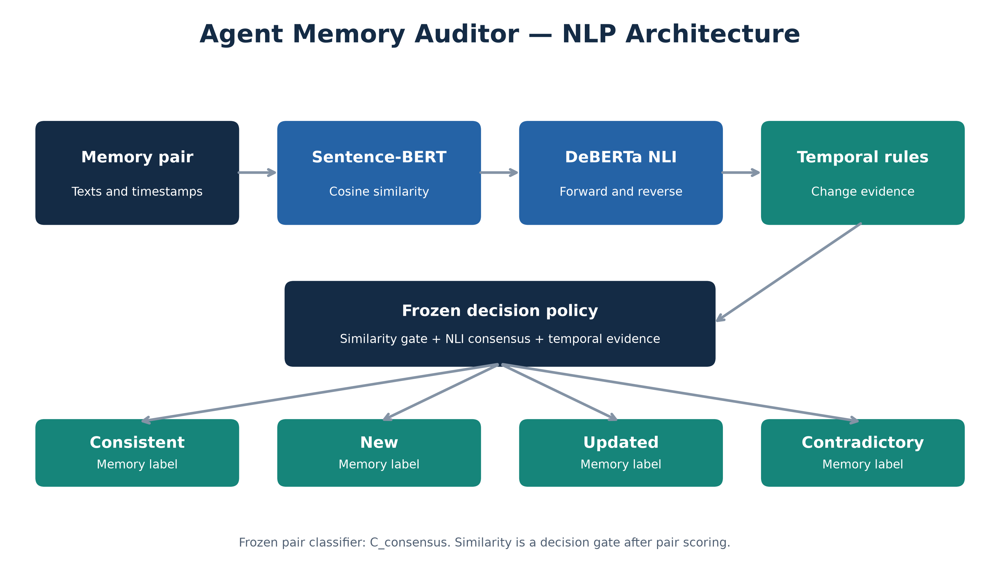
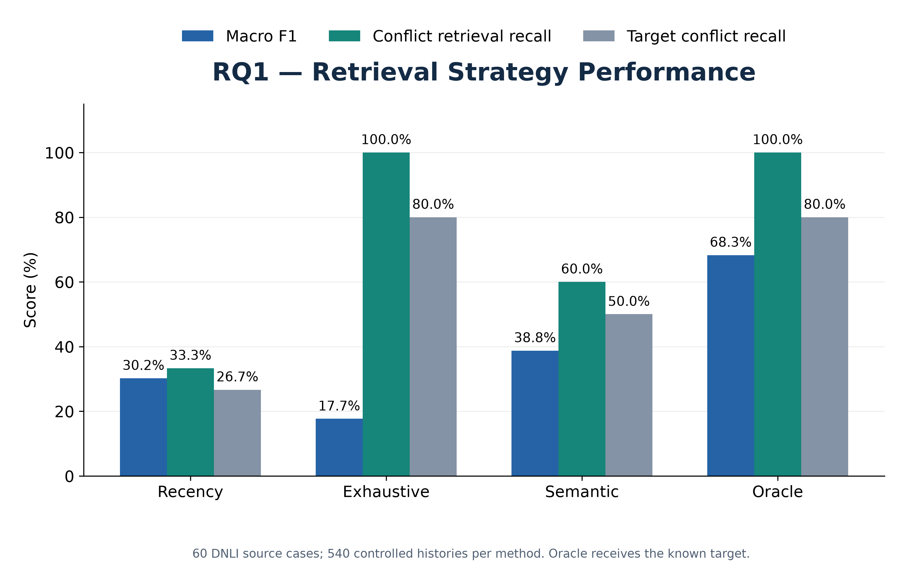
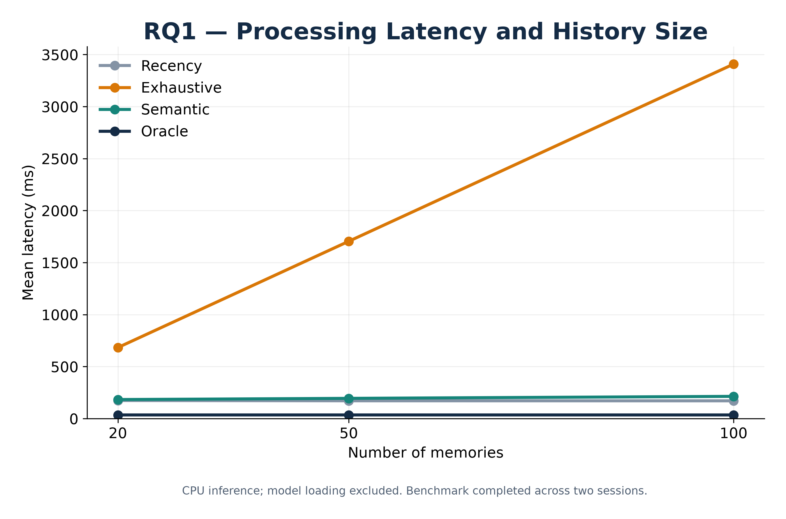
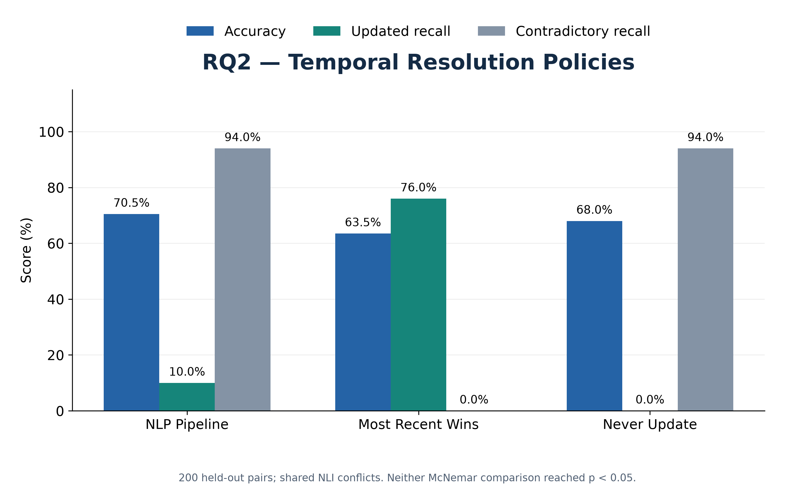
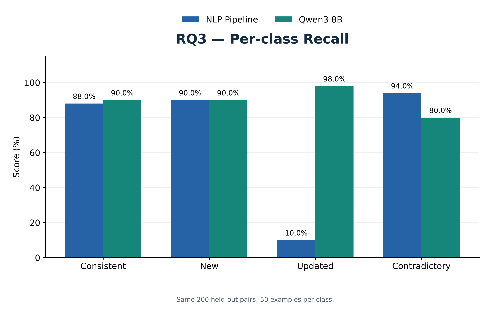
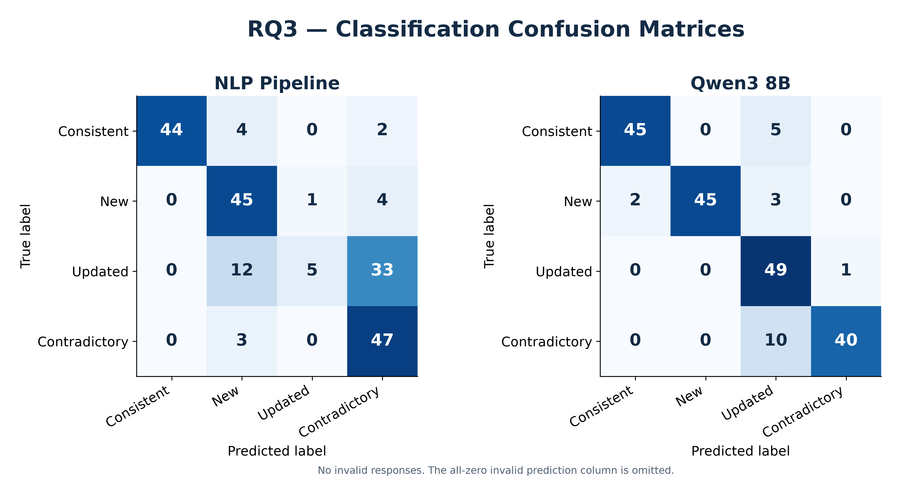
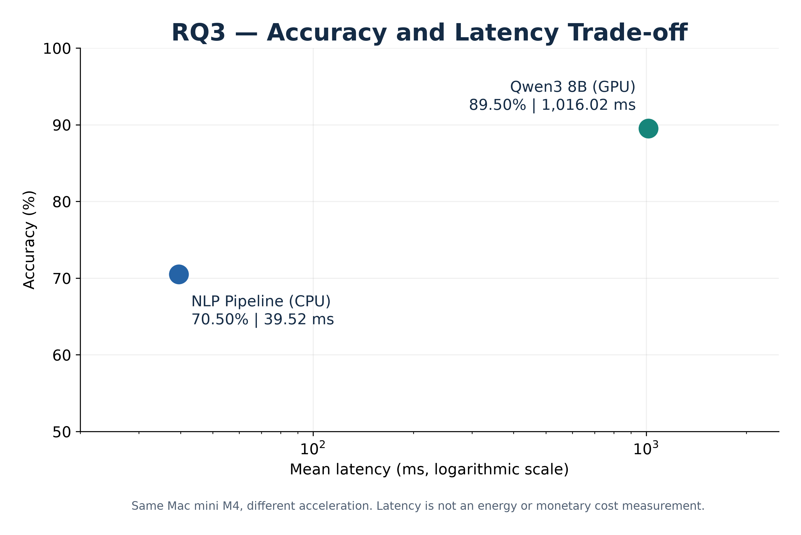
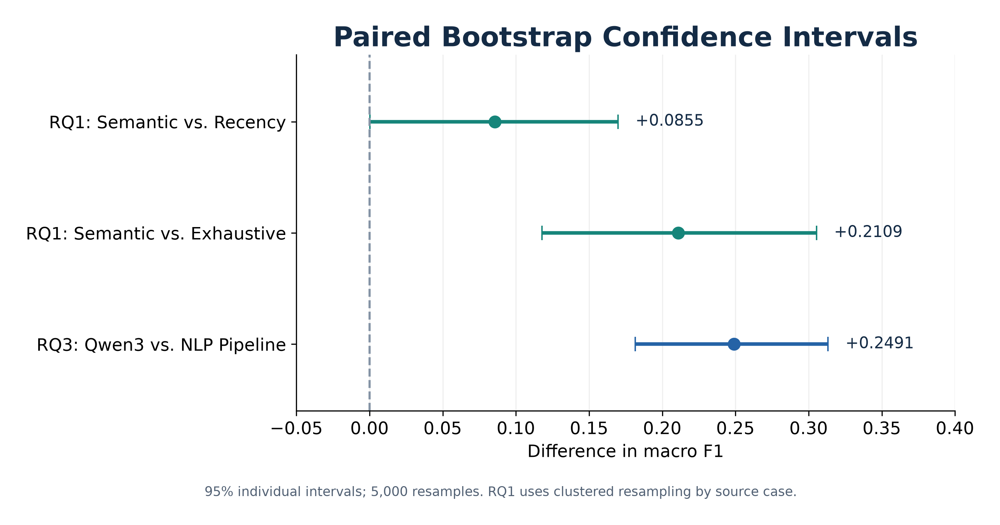

# Agent Memory Auditor

### Local-first NLP for conversational memory consistency


## Author

**Gabriel Cruz Castro**

Florida International University

CAI 4304 — Natural Language Processing

Project author, principal researcher, dataset curator,
and annotation reviewer.

---

## Overview

Agent Memory Auditor is a local-first research prototype
designed to evaluate the consistency of conversational
agent memory.

Persistent memory introduces a fundamental challenge:
new information may confirm, extend, replace, or
contradict previously stored facts.

This project investigates how semantic retrieval,
natural language inference, and temporal reasoning
can identify these relationships without automatically
modifying stored memories.

## System Architecture



The implemented NLP architecture combines:

- Sentence-BERT semantic embeddings.
- Cosine similarity and top-k retrieval.
- DeBERTa-v3 bidirectional natural language inference.
- Temporal change detection.
- Deterministic memory classification rules.
- Traceable prediction and evaluation records.

### Memory Classification

| Label | Interpretation |
|---|---|
| `consistent` | Equivalent or supported information. |
| `new` | Compatible additional information. |
| `updated` | Legitimate replacement of an earlier fact. |
| `contradictory` | Incompatible information without sufficient evidence of change. |

### Example

Existing memory:

> I live in Miami.

Incoming memory:

> I no longer live in Miami. I moved to Boston.

Expected memory relationship: `updated`.

The objective is to distinguish a legitimate change
from an unresolved contradiction.

## Research Questions

| ID | Research Question |
|---|---|
| RQ1 | Semantic retrieval effectiveness and computational cost. |
| RQ2 | Temporal updates versus contradictions. |
| RQ3 | Classification and latency comparison against a local LLM judge. |

## Experimental Design

### Four-label Memory Corpus

| Split | Pairs |
|---|---:|
| Development | 100 |
| Held-out | 200 |
| Total | 300 |

The synthetic corpus is balanced across four labels,
with 75 examples per class.

The held-out evaluation contains 50 examples per class.

The complete 300-pair synthetic corpus was constructed, curated,
annotated, and validated by Gabriel Cruz Castro, the sole
author and principal researcher of this project.

The researcher's responsibilities and personal annotation review are clarified in the [annotation review clarification](docs/annotation_review_clarification.md).

Dataset construction, provenance, annotation procedures,
and split limitations are documented in the
[annotation audit](docs/heldout_annotation_audit_2026-11-24.md).

### Dialogue NLI Retrieval Benchmark

RQ1 uses a separate experimental design constructed
from Dialogue NLI.

- 60 source cases.
- 540 controlled memory histories.
- 2,160 method evaluations.
- History sizes: 20, 50, and 100 memories.
- Target positions: old, middle, and recent.
- Semantic retrieval: top-k = 5.

## Research Results

### RQ1 — Semantic Retrieval

| Method | Macro F1 | Conflict retrieval recall | Mean latency |
|---|---:|---:|---:|
| Recency | 0.3021 | 33.33% | 171.84 ms |
| Exhaustive | 0.1767 | 100.00% | 1,931.90 ms |
| Semantic | 0.3876 | 60.00% | 197.00 ms |
| Oracle | 0.6827 | 100.00% | 34.91 ms |



Semantic retrieval reduced NLI pair comparisons
by 91.18% relative to exhaustive retrieval.

Mean processing latency was approximately
9.81 times lower.

However, semantic retrieval did not achieve
oracle-level recall.



Retrieval effectiveness decreased as memory
history size increased.

### RQ2 — Temporal Reasoning

| Policy | Accuracy | Macro F1 |
|---|---:|---:|
| NLP Pipeline | 70.50% | 0.6488 |
| Most Recent Wins | 63.50% | 0.5652 |
| Never Update | 68.00% | 0.5969 |



The implemented temporal policy achieved the highest
observed accuracy and macro F1.

However, neither paired McNemar comparison reached
statistical significance at the 0.05 level.

Limited temporal rule coverage remains an important
source of classification errors.

### RQ3 — Local LLM Comparison

The specialized NLP pipeline was compared with
Qwen3 8B using the same 200 held-out memory pairs.

| Metric | NLP Pipeline | Qwen3 8B |
|---|---:|---:|
| Accuracy | 70.50% | 89.50% |
| Macro F1 | 0.6488 | 0.8980 |
| Updated recall | 10.00% | 98.00% |
| Contradictory recall | 94.00% | 80.00% |
| Mean latency | 39.52 ms | 1,016.02 ms |



Qwen3 achieved a 19 percentage-point accuracy
improvement.

The NLP pipeline processed memory pairs approximately
25.71 times faster under the recorded configuration.

### Classification Error Analysis



The NLP pipeline correctly identified 47 of 50
contradictions but only 5 of 50 legitimate updates.

Qwen3 correctly identified 49 of 50 updates but
classified 10 genuine contradictions as updates.

### Accuracy and Latency



Both systems were evaluated on an Apple M4 system.

The NLP pipeline used CPU inference, while Qwen3
was observed using GPU acceleration through Ollama.

Latency comparisons therefore describe the measured
system configurations, not identical accelerator
conditions.

### Statistical Evaluation



For RQ3:

- Macro-F1 improvement: 0.2491.
- Paired 95% confidence interval: [0.1816, 0.3132].
- McNemar p-value: 0.00001484.

The observed classification difference supports
the advantage of the local LLM on this corpus.

## Technology Stack

| Component | Technology |
|---|---|
| Language | Python 3.12 |
| Semantic retrieval | Sentence-BERT / MiniLM |
| NLI | DeBERTa-v3 |
| Numerical computation | NumPy |
| Evaluation | scikit-learn |
| Statistical analysis | SciPy and NumPy |
| Local LLM | Qwen3 8B Q4_K_M |
| LLM runtime | Ollama |
| Visualization | Matplotlib |
| Testing | Pytest |
| Code quality | Ruff |

## Repository Structure

```text
agent-memory-auditor/
├── configs/       # Frozen LLM prompt
├── datasets/      # Development and held-out corpus
├── docs/          # Research documentation and figures
├── examples/      # Demonstration scripts
├── results/       # Archived experimental results
├── scripts/       # Evaluation and reproducibility tools
├── src/           # Core NLP implementation
├── tests/         # Automated tests
├── pyproject.toml
└── README.md
```

## Installation

The recorded research environment used Python 3.12.16.

```bash
python3.12 -m venv .venv
source .venv/bin/activate
python -m pip install -e ".[dev,retrieval]"
python -m pytest -q
```

Run the semantic retrieval demonstration:

```bash
python examples/semantic_retrieval_demo.py
```

The quickstart may download model weights on first use.

The exact research model revisions and recorded
package versions are available in
[model revisions](docs/model_revisions_v0_1.json).

## Reproducibility

The repository preserves:

- Frozen dataset manifests.
- Model revision identifiers.
- Frozen classification policy.
- Frozen local LLM configuration.
- Archived prediction records.
- Statistical evaluation scripts.
- SHA-256 integrity checks.

### Dialogue NLI Preparation

RQ1 reproducibility requires the original Dialogue NLI
archive in the local cache.

Download the verified archive:

```bash
mkdir -p ~/.cache/agent-memory-auditor/dnli

curl -fL \
  'https://huggingface.co/datasets/xksteven/dialogue_nli/resolve/34a0a573de2e33685141b3506438b1670b5659f4/dnli.zip' \
  -o ~/.cache/agent-memory-auditor/dnli/dialogue_nli.zip
```

The preparation script verifies the archive SHA-256
before constructing the controlled experimental design.

```bash
python -m scripts.prepare_rq1
```

Skip preparation if the verified design already exists.

### Statistical Reproduction

With the recorded dependencies and verified RQ1
design available, execute:

```bash
python -m scripts.verify_reproducibility
```

Expected results in the recorded research environment:

```text
Reproduced analyses: 6
Original results preserved: PASS
New model inference: NONE
FULL REPRODUCIBILITY AUDIT: PASS
```

All six statistical outputs were reproduced
byte-for-byte in an isolated temporary workspace.

The reproducibility audit also verifies the corrected
corpus metadata against the historical research revision.

The original experimental records remain available
through Git history. A full Git clone containing the
historical revision is required for this audit.

The metadata correction does not change memory texts,
gold labels, temporal markers, classifier predictions,
or numerical experimental results.

This verifies statistical reproducibility from archived
predictions, rather than cross-platform inference
reproducibility.

### Scientific Figures

A separate visualization environment protects the
original inference dependencies.

```bash
python3.12 -m venv ~/.cache/agent-memory-auditor/viz-venv

~/.cache/agent-memory-auditor/viz-venv/bin/python \
  -m pip install -r docs/requirements-viz.txt

~/.cache/agent-memory-auditor/viz-venv/bin/python \
  -m scripts.generate_figures
```

All figures are generated directly from archived
experimental metrics and exported as PNG and SVG.

## Quality Assurance

```bash
python -m ruff check src tests examples scripts
python -m pytest -q
```

Research milestone:

| Quality Control | Result |
|---|---|
| Automated tests | 138 passed |
| Statistical analyses reproduced | 6/6 |
| Byte-identical statistical outputs | 6/6 |
| Scientific figures | 8 |
| Archived result integrity | Verified |

## Research Documentation

- [Experimental conclusions](docs/research_conclusions_v0_1.md)
- [Annotation guide](docs/annotation_guide.md)
- [Held-out annotation audit](docs/heldout_annotation_audit_2026-11-24.md)
- [Held-out evaluation protocol](docs/heldout_protocol_v0_1.md)
- [Frozen NLP policy](docs/policy_freeze_v0_1.json)
- [Model revisions](docs/model_revisions_v0_1.json)
- [Frozen LLM configuration](docs/rq3_freeze_v0_1.json)
- [Scientific figure manifest](docs/figures/manifest_v0_1.json)

## Supplementary Scientific Review

A post-evaluation diagnostic identified lexical
patterns associated with the corpus labels.

Single-memory classifiers achieved 50.00% and
52.50% accuracy, compared with a 25% random reference.

The analysis also examines the development-to-test
performance gap and the methodological limitations
of the local LLM comparison.

See the [final scientific review](docs/final_scientific_review_2026-11-27.md).

## Known Limitations

- Synthetic four-label evaluation corpus.
- Limited temporal rule coverage.
- Retrieval recall degradation for larger histories.
- Potential additional conflicts in DNLI distractors.
- No independent annotation agreement established.
- Different inference acceleration configurations.
- Limited evidence of real-world generalization.

The complete methodological limitations and deviations
are documented in the experimental conclusions.

## Privacy and Safety

The prototype performs read-only memory auditing.

It does not automatically overwrite, delete, or
replace existing memories.

The recorded experiments were conducted locally
using research datasets.

## Future Work

The results motivate further investigation of:

- Hybrid NLP and local LLM architectures.
- Selective LLM escalation for difficult memory pairs.
- Improved temporal reasoning.
- Larger and independently annotated datasets.
- Real-world conversational memory evaluation.
- More efficient retrieval and inference strategies.

These extensions have not yet been experimentally
validated.

## Project Status

Version 0.1.1 — Academic research prototype.

All three research questions have been evaluated.
Experimental results, statistical analyses, and
reproducibility tools are available.

Developed for CAI 4304 — Natural Language Processing,
Florida International University, Fall 2026.

## License

The original project code is licensed under the
[MIT License](LICENSE).

Dataset and third-party resource conditions are
described in [NOTICE.md](NOTICE.md).
